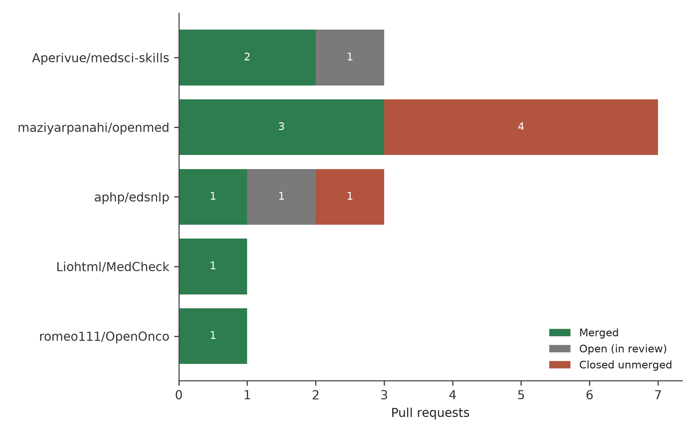
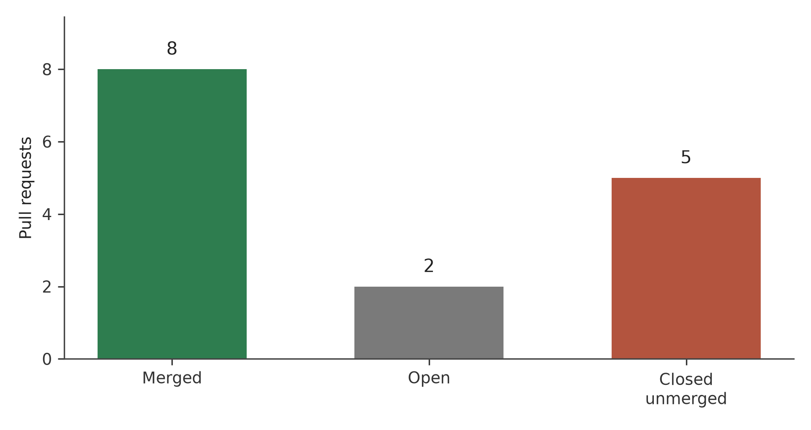
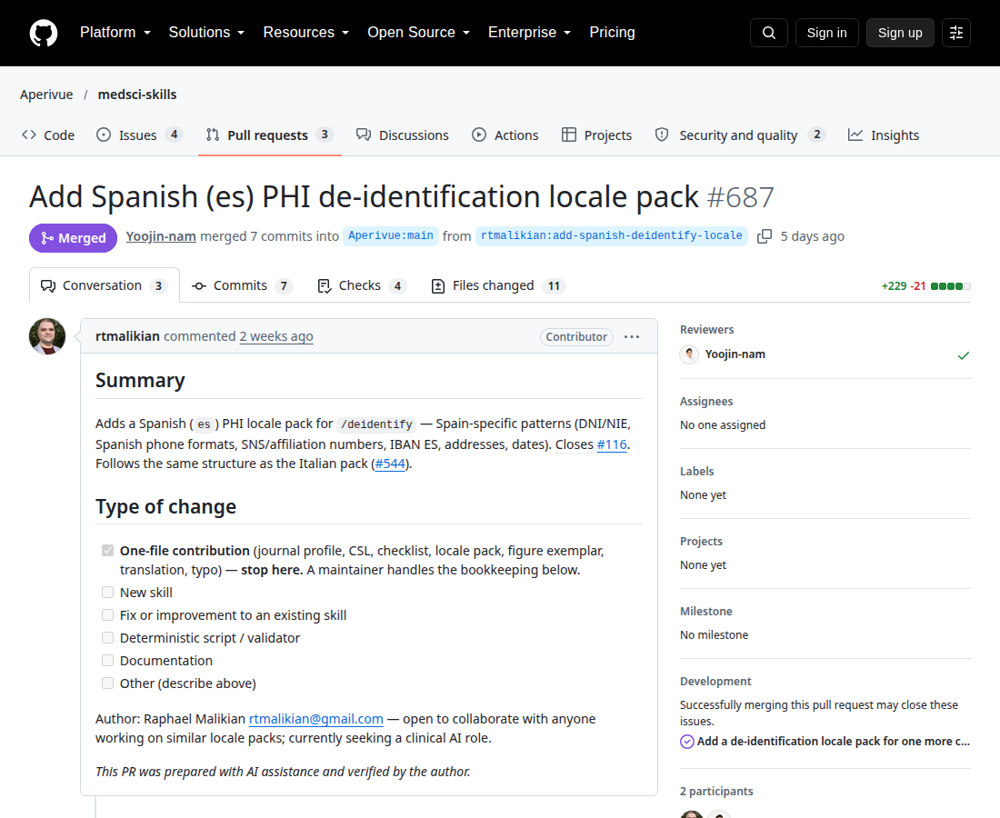

# Guarding the Clinical Narrative: A Practitioner-Contributor's Retrospective Analysis of Open-Source Contributions to Clinical Natural Language Processing and Health-Data De-identification (2025-2026)

**Author:** Raphael T. Malikian, MBBS BSc (Hons), Independent Researcher, Palmdale, California, USA
**Profile:** https://github.com/rtmalikian

[](https://doi.org/10.5281/zenodo.23549061)
**Preprint:** [Zenodo](https://doi.org/10.5281/zenodo.23549061) | **License:** CC BY 4.0 | **PDF:** [article1-clinical-nlp.pdf](article1-clinical-nlp.pdf)

Under review at Methods of Information in Medicine (Manuscript ME26-01-0319). Preprint: Zenodo.

## About this paper

This paper studies clinical natural language processing and health data de-identification through one contributor's public pull request record. It covers 15 pull requests in 5 repositories, with 8 merged and 13 resolved. The cases include identifier handling in Italian, Spanish, French and Ukrainian text, a date pattern fault in a French hospital NLP library, and a change that stopped protected health information entering version control.

## Full article

## Abstract

**Background.** Clinical natural language processing (NLP) software extracts structured facts from free-text notes. De-identification software removes protected health information (PHI) so that text can be shared for research. A missed name or a broken date pattern can expose a patient or corrupt a dataset. Much of this software is open source, and outside contributors write part of it.

**Purpose.** This study describes what one practitioner-contributor did in this area, what got merged, what did not, and what the review process taught about working well with maintainers.

**Methods.** The data source was the author's public pull request (PR) record on GitHub, extracted with the GitHub REST API on 21 October 2026 (search: author:rtmalikian, type:pr). The full record held 213 PRs across 94 repositories. This paper analyses the clinical NLP and de-identification subset: 15 PRs in 5 repositories. Each PR was classed as merged, open, or closed unmerged. Seven cases were selected for close reading for their privacy or language point, or for a hard review lesson.

**Results.** Eight of the 15 subset PRs merged, which is 61.5% of the 13 resolved PRs. Five closed unmerged. Two remained open. Merged work included a fix for placeholder collisions in a de-identification function, Italian and Spanish PHI locale packs, a date-pattern fix in a French hospital NLP library, and a change that stopped PHI entering version control. The hardest case, a Spanish locale pack, survived a blocking review that found real damage in a follow-up commit. A fix-forward commit repaired it, and the PR merged the next day.

**Conclusions.** The record points to a plain finding. PHI safety in this software rests on ordinary engineering habits: reproduction before repair, small scope, tests run before submission, and calm correction when a reviewer finds a fault. Language coverage is part of safety. De-identification that works only in English leaves other patients less protected.

---

## 1. Introduction

Clinical notes carry the story of care. They also carry names, dates, addresses, phone numbers, and record numbers. United States law treats 18 categories of identifiers as protected health information, and the HIPAA Safe Harbor method requires their removal before data can be treated as de-identified [1]. Research datasets such as MIMIC-III exist because de-identification was done at scale and done carefully [2]. Neamatullah and colleagues showed in 2008 that automated de-identification of narrative text was feasible, and they also showed where it failed [3]. The i2b2 shared tasks then gave the field shared corpora and shared measures for the problem [4,6]. Neural methods improved recall further [5]. The work continues because the stakes stay the same. A false negative is a person exposed.

Clinical NLP has a wider job than de-identification. Meystre and colleagues reviewed early extraction work in 2008 [7]. Wang and colleagues reviewed clinical information extraction again a decade later and found a field still dependent on careful, task-specific engineering [9]. Velupillai and colleagues made a similar point for health outcomes research: the methods help, and the limits need plain statement [8]. Deep learning changed the tooling [32], and reviews of artificial intelligence in health care describe broad ambition [27,33]. Ambition does not remove the small defects. Software that parses a time written as 14:00:00 can still fail on the seconds field. A redaction function can still assign the same placeholder twice.

Open-source projects carry much of this tooling. Hospitals, universities, and small teams publish code and accept changes from strangers through pull requests. Gousios and colleagues studied pull-based development and found that review workload and contributor history shape what happens to a change [13,14]. Tsay and colleagues found that social and technical signals both affect whether a PR is accepted [15]. Marlow and colleagues showed that contributors form impressions of each other from thin online traces [16]. De-identification code is reviewed in public, by volunteers, under the same pressures as any other code.

### 1.1 Purpose of the Paper

Published work on clinical NLP reports model performance on shared corpora [2,4,5,9]. Published work on open-source contribution reports aggregate behaviour across thousands of contributors [13,15,17,18]. The two literatures rarely meet at the level of one person's reviewed work in safety-adjacent health software. That gap is the reason for this paper. A single-contributor record can be read end to end, and every outcome in it has a public thread attached.

This paper therefore asks three questions.

**RQ1.** What did the merged contributions in the clinical NLP and de-identification subset actually change, stated in clinical terms?

**RQ2.** What happened to the contributions that closed unmerged or stayed open, and what patterns explain those outcomes?

**RQ3.** Which working habits kept disagreement with maintainers short, factual, and repairable?

The paper adds a checked dataset (Section 2), a case-level account of merged and failed work (Section 3), and a reflective analysis of one contributor's review relationships (Section 4). Section 4.5 states the limits of the design.

## 2. Methods

### 2.1 Data source and extraction

Data came from the GitHub REST API search endpoint on 21 October 2026, with the query `author:rtmalikian type:pr`. The search returned 213 PRs across 94 repositories, with no sampling. Repository names, PR numbers, titles, states, and merge or closure dates were taken from the API response. Where this paper discusses review events in depth, the account also draws on the public comment threads on the PRs themselves. Any reader can repeat the search and compare counts.

### 2.2 Subset definition

The subset was defined before counting, by topic. A PR entered the subset if its target repository had clinical NLP or health-data de-identification as a main function, or if the change itself concerned PHI handling or clinical language coverage. Five repositories met the rule: maziyarpanahi/openmed, Aperivue/medsci-skills, aphp/edsnlp, Liohtml/MedCheck, and romeo111/OpenOnco. The subset held 15 PRs. Work on medical imaging, FHIR infrastructure, synthetic data, and vector databases sits outside the subset and is reserved for later papers in this series.

### 2.3 Status definitions

A PR was coded **merged** if the API recorded a merge timestamp. It was coded **closed unmerged** if its state was closed with no merge timestamp. It was coded **open** if its state was open at extraction. These are platform facts. They need no judgement from the author, which is the point of using them.

### 2.4 Case selection

Seven cases were selected for close reading. Selection favoured PRs where the clinical reason for the change could be stated in one sentence, plus PRs where review went badly or nearly did. One open PR and one group of closed PRs were included on purpose. A sample of successes alone would mislead.

### 2.5 Contribution workflow under study

The workflow that produced these PRs was fixed in advance, and it forms part of the exposure described here. The defect had to be reproduced locally before any fix was written. Tests had to pass locally before a PR was opened. Each repository's own PR template outranked the author's preferred format. Every commit carried a Developer Certificate of Origin sign-off. History was never rewritten on a shared branch. Corrections went in as new commits, a fix-forward pattern. Section 4.4 examines what happened when that workflow met a real review failure.

### 2.6 Ethics

Ethics review was not required for this study. It used public software records only. It used no patient data, no clinical records, and no private communications. Reporting follows the spirit of the STROBE and RECORD statements for observational studies that use routinely collected data [25,26], adapted to a data source those statements never imagined: a version control platform.

## 3. Results

### 3.1 The subset in numbers

Of the 15 PRs in the clinical NLP and de-identification subset, 8 merged, 2 were open at extraction on 21 October 2026, and 5 had closed unmerged. Table 1 gives the split by repository. Figure 1 shows the same split as bars: OpenMed closed more than it merged. Figure 2 summarises the subset as a whole. Among the 13 resolved PRs, the merge share was 61.5%. For scale, the author's full record at the same extraction held 213 PRs across 94 repositories: 56 merged, 55 closed unmerged, and 102 open. The subset merged at a higher rate than the full record. One reason is scope. These repositories are smaller, and the defects were narrower.

**Table 1.** Pull requests in the clinical NLP and de-identification subset, by repository and status at 21 October 2026.

| Repository | PRs | Merged | Open | Closed unmerged |
|---|---:|---:|---:|---:|
| maziyarpanahi/openmed | 7 | 3 | 0 | 4 |
| Aperivue/medsci-skills | 3 | 2 | 1 | 0 |
| aphp/edsnlp | 3 | 1 | 1 | 1 |
| Liohtml/MedCheck | 1 | 1 | 0 | 0 |
| romeo111/OpenOnco | 1 | 1 | 0 | 0 |
| **Total** | **15** | **8** | **2** | **5** |

**Figure 1.** Pull requests by repository, grouped by outcome at 21 October 2026. OpenMed contributed the largest share of the subset and the largest share of closures. Medsci-skills had no closures in the subset.



<!-- FIGURE 1 DATA (plot verbatim). Chart type: horizontal grouped bar chart. Categories (repositories): maziyarpanahi/openmed; Aperivue/medsci-skills; aphp/edsnlp; Liohtml/MedCheck; romeo111/OpenOnco. Series "Merged": 3, 2, 1, 1, 1. Series "Open": 0, 1, 1, 0, 0. Series "Closed unmerged": 4, 0, 1, 0, 0. Repository totals: 7, 3, 3, 1, 1. Grand total: 15. -->

**Figure 2.** Outcome summary for the clinical NLP and de-identification subset at 21 October 2026. Merged PRs form the majority of resolved work. The five closed PRs are a large minority, and this paper treats them as data.



<!-- FIGURE 2 DATA (plot verbatim). Chart type: bar chart or donut chart. Categories and values: Merged 8 (53.3% of 15); Open 2 (13.3% of 15); Closed unmerged 5 (33.3% of 15). Total: 15. Resolved PRs: 13, of which merged 8 (61.5%). -->

### 3.2 Case studies

Table 2 summarises the seven cases read closely. The text below gives the clinical reason for each one. Figure 3, a screenshot of the merged PR page for Case 3, sits with that case because the page records the review history that Section 4.4 discusses.

**Table 2.** Cases selected for close reading.

| Case | Repository and PR | Outcome | Point of the case |
|---|---|---|---|
| 1 | maziyarpanahi/openmed #371 | Merged 18 Jun 2026 | Placeholder collisions in de-identification output |
| 2 | Aperivue/medsci-skills #544 | Merged 1 Oct 2026 | Italian PHI patterns for de-identification |
| 3 | Aperivue/medsci-skills #687 | Merged 17 Oct 2026 | Spanish PHI patterns; blocking review repaired by a fix-forward commit |
| 4 | aphp/edsnlp #517 | Merged 8 Sep 2026 | Time patterns with 00 minutes or seconds in French notes |
| 5 | Liohtml/MedCheck #116 | Merged 19 Jun 2026 | PHI kept out of version control; HTTP security headers |
| 6 | romeo111/OpenOnco #648 | Merged 4 Oct 2026 | Interface language matched to the reader's language on oncology plan pages |
| 7 | Aperivue/medsci-skills #692; four openmed PRs (Jun 2026); aphp/edsnlp #514 | Open; closed unmerged | Work still under review, and work that failed |

**Case 1: placeholder collisions in OpenMed.** OpenMed is a clinical NLP library with a HIPAA de-identification pipeline [28]. Its `deidentify()` function replaces each detected entity with a placeholder. When one document contained repeated entity types, placeholders could collide. Two different people could end up marked with the same tag. Redaction stayed inconsistent across a single document. PR #371 gave each repeated entity type a unique placeholder. It closed issue #222 and merged on 18 June 2026. The defect was small. The failure mode was the kind that privacy guidance warns about: de-identification that looks complete, with a quiet flaw inside it [1,11].

**Case 2: Italian locale pack for medsci-skills.** Medsci-skills is a set of medical research skills with de-identification tooling that works from locale packs [30]. A locale pack encodes how identifiers look in one country and language. PR #544 added the Italian pack. It covered the codice fiscale tax code, Italian phone and address formats, and day-month-year dates. The maintainer, Yoojin-nam, reviewed at algorithm level. The pack merged on 1 October 2026 after that review round.

**Case 3: Spanish locale pack, medsci-skills #687.** PR #687 added the Spanish pack and closed issue #116. It merged on 17 October 2026. The path to that merge was rough. A follow-up commit damaged two files. The maintainer blocked the PR with a precise review on 16 October. A fix-forward commit repaired the damage the same day, the full scan suite passed 134 of 134 checks, and the PR merged the next day. Section 4.4 gives the full account.

[FIGURE 3: Screenshot, medsci-skills PR #687 merged pull request page]

**Figure 3.** The merged pull request page for Aperivue/medsci-skills PR #687. The page records the merge on 17 October 2026, one day after the blocking review of 16 October 2026. Screenshot to be inserted at rendering.



**Case 4: zeros in French clinical times, edsnlp #517.** EDS-NLP is the clinical NLP library built for Assistance Publique-Hopitaux de Paris (AP-HP), the Paris public hospital system [29]. Its date and time patterns feed temporal extraction from French clinical notes. Times with 00 minutes or 00 seconds matched inconsistently. A note recording an event at 14:00 could lose that time or parse it differently from other times. PR #517 made the minute and second patterns handle 00 consistently. It merged on 8 September 2026. Data quality work in electronic health records has long made the same point in other settings: small capture and parsing faults become analytic errors later [22,23].

**Case 5: PHI and version control, MedCheck #116.** PR #116 in Liohtml/MedCheck addressed a route to harm that had nothing to do with NLP accuracy. Files that could contain PHI were not excluded from version control. One careless commit could have copied patient details into a public history, where deletion is hard and copies spread fast. The PR closed that route with ignore rules and added standard HTTP security headers. It merged on 19 June 2026 after a thread of 9 comments. Re-identification risk and plain disclosure risk are different problems. Both end with a person exposed [10,12].

**Case 6: language on oncology plan pages, OpenOnco #648.** OpenOnco produces oncology treatment plan pages for patients and clinicians. A defect in label resolution let English interface labels appear on Ukrainian-language plan pages. PR #648 fixed the resolution so a page renders fully in the language its reader selected. It merged on 4 October 2026. A plan page is a clinical document. A patient reading a plan in a second language, with labels leaking in from a third, is being asked to do extra work at a bad time.

**Case 7: the open and the closed.** Two PRs were still open at extraction. One is medsci-skills #692, opened on 21 October 2026, which adds a citation style for Methods of Information in Medicine for the project's reference tooling. Its fate is unknown at writing. Five PRs closed unmerged (Table 1, Figure 2). Four were OpenMed PRs from June 2026. One of the four was superseded: a narrower fix for the same issue (#399) merged in its place, and the narrower fix was the better change. The fifth was edsnlp #514. Section 4.4 returns to the closed set, because the closed set carries half the lessons in this record.

## 4. Discussion

### 4.1 PHI safety is a software engineering property

Privacy discussion in health data often centres on policy: who may see data, under what agreement, for what purpose [11,12]. Policy matters. Cases 1 and 5 in this record failed at a lower level. Case 1 was a variable-handling defect inside a redaction function. Case 5 was a missing ignore file. No policy document would have caught either one. Tests caught the first. Review caught the second.

That pattern matches the older de-identification literature. Neamatullah and colleagues evaluated an automated system and reported its errors case by case [3]. El Emam and colleagues reviewed re-identification attacks and showed that release decisions rest on the actual state of the data, which rests on the actual state of the code [10]. Kahn and colleagues framed data quality as fitness for use, assessed attribute by attribute [22]. A de-identification pipeline deserves the same treatment. It is fit for use when its placeholders stay unique per entity and when its outputs have been tested on text that resembles real notes [2,4].

The practical point for contributors is direct. A PR to de-identification code should be reviewed as a safety change, even when the diff is ten lines. The MedCheck thread took 9 comments for a change with no model in it at all. That was time well spent.

### 4.2 Localisation is an equity issue in de-identification

De-identification research has an English bias. The shared corpora are English [4,6]. The best-known benchmark dataset is English [2]. Patients write and are written about in other languages. Their identifiers look different. An Italian codice fiscale has a fixed structure that an English-tuned pattern will miss. Spanish identifiers follow their own formats. French hospital notes write dates and times in French conventions, inside a French hospital system's own pipeline [29].

Cases 2, 3, and 4 in this record were localisation work. Case 6 was localisation work in a patient-facing tool. Together they made up half the merged subset. That share surprised the author. It should not have. A de-identification tool with strong English performance and weak Spanish performance gives uneven protection, and the unevenness follows language lines. Topaz and colleagues found related gaps when they mined nursing notes for fall-related information: what the text contains depends on who wrote it and how [24]. Shickel and colleagues, in their survey of deep learning for health records, noted how much of the evidence base comes from a narrow set of sources [32].

Locale packs are unglamorous work. A pack is a list of patterns, formats, and test fixtures. Reviewers have to check examples one by one, as Yoojin-nam did on PR #544. The work scales badly and reads badly in a grant application. It is also the difference between a tool that protects a hospital's whole patient population and a tool that protects part of it.

### 4.3 Small defects carry clinical weight in this domain

Every merged change in the subset was small. None changed an architecture. None introduced a model. The changes fixed placeholder assignment, added pattern files, corrected two time patterns, added ignore rules, and repaired label lookup. In many software domains, changes of this size are housekeeping. In clinical text software, size and consequence come apart.

A time pattern that drops 14:00 can move a recorded event out of a timeline. Temporal extraction feeds cohort definitions, outcome windows, and audit. Weiskopf and Weng set out the dimensions along which electronic health record data can mislead research, and they put completeness and correctness at the centre [23]. A placeholder collision can merge two patients inside a de-identified file. A merged patient is a corrupted record and a privacy fault in the same object. Wang and colleagues made the general version of this point in their review of clinical information extraction: downstream use inherits upstream error [9].

The corollary is about review effort. Reviewers in this record spent their longest threads on small diffs. They were right to. The correct unit of caution in this domain is the failure mode, and failure modes do not scale with diff size.

### 4.4 Reflective analysis: rational, supportive teamwork as conflict prevention

This section is written in the first person. The events are mine, and the faults in them are mine.

**The low point came on 16 October 2026.** I built the follow-up commit for PR #687 from a stale copy of the code. The reviewer caught it. She was right. My commit had reverted two improvements on the main branch of medsci-skills: a date-shift method in `deidentify.py` went back to a seed that a reader could brute-force, and date patterns that the main branch had gained were gone. Test checks vanished with them. Yoojin-nam blocked the PR and named each loss in her review. She did the work my own diff check should have done.

My reply did three things, in this order. I agreed with the review in writing, point by point. I restored the main-branch versions of both files and re-applied only the Spanish additions. I pushed the repair as a new commit on top of the bad one. I did not rewrite history and I did not force-push. The branch record still shows the mistake and the repair side by side, and any reader of Figure 3 can follow the thread from block to merge. The full scan suite passed 134 of 134 checks. The PR merged the next day.

The fix-forward habit matters for trust. A force-push erases the evidence of an error and asks the reviewer to start again from a clean-looking branch. A fix-forward commit keeps the record honest and keeps the reviewer's earlier work valid. Research on pull-based development has shown that maintainers judge contributors partly on history and conduct [13,14,15]. Raymond described the same social contract in 1999, in plainer language: reputation in open source is built in public and lost in public [19]. Crowston and colleagues, in their review of what is known about free and open-source development, reached a similar conclusion about coordination and trust in distributed teams [18].

**The closed PRs taught a second lesson.** Four of my OpenMed PRs closed unmerged in June 2026. One was superseded by a narrower fix for issue #399, and the narrower fix was better than mine. My version reached further than the defect required. Steinmacher and colleagues catalogued the barriers newcomers face in open-source projects, and poor task scoping sits high on that list [17]. Baltes and Diehl, in their work on software development expertise, describe how judgement about scope grows with reviewed practice [20]. I read those closures as tuition. The fee was a few evenings. The lesson, scope to the defect and stop, has raised my merge rate since.

**Two smaller habits did quiet work.** First, ask before acting on any request that touches history. A maintainer's instruction about rebasing or closing can be read two ways, and a wrong guess costs goodwill. One clarifying question costs a minute. Second, keep replies short, factual, and kind, and answer every bot flag and reviewer checklist item rather than letting it sit. Forsgren and colleagues linked delivery performance to small batches and fast feedback in software teams [21]. The same pattern held here at kitchen-table scale: small PRs, fast replies, quick repairs. Disagreement stayed about code. It never became about people.

There were flat weeks in this record. PRs sat unreviewed. Two subset PRs are open as I write, and 102 PRs across my full record are open with them. Silence is the normal weather of open source, and it still stings at midnight after a careful fix. The discipline that helped was routine: log the state, move to the next defect.

### 4.5 Limitations

This study has clear limits. It covers one contributor, so nothing here generalises to other contributors without further work. The author coded his own record, and self-report bias is a real risk in autoethnography; the use of platform status fields and public threads reduces that risk and cannot remove it. Survivorship bias is present in the case selection, partly corrected by the inclusion of the closed set. Two subset PRs were still open at extraction, so the merge share of 61.5% will move as they resolve. The study measured code outcomes only. It measured no downstream clinical outcome, no change in any hospital's practice, and no patient-level effect. Claims in this paper stay inside those bounds.

## 5. Conclusions

The subset record supports a modest claim, stated at the size the data can carry. In clinical NLP and de-identification software, the merged work in this record was small, language-aware, and heavily reviewed. The failed work failed for readable reasons: scope too wide, a stale working copy, a better competing fix. None of the failures needed a quarrel. Each one needed a correction or a narrower change.

One claim in this record is not modest, and the count behind it is four of eight. De-identification that works only in English is not finished safety equipment. Two of the eight merged PRs in this subset exist for one reason: identifiers in Italian and Spanish text were passing through tooling built around English formats. A third merged case repaired time patterns in French clinical text, and a fourth stopped English labels reaching Ukrainian oncology plan pages. Half the merged work was language repair. A de-identification tool that has not been tested against the languages in the notes it will process has been tested against a subset of the risk, and its documentation should say so.

For practitioners who contribute to health open-source projects, the working rules from this record are plain. Reproduce the defect before you write the fix. Keep the change at the size of the defect. Treat your repository's template and sign-off rules as part of the clinical governance of the change. When a reviewer finds a fault in your work, repair forward, in the open, and say plainly what went wrong. And write the locale pack. Somebody's mother is in those notes, in her own language.

### 5.1 Future Work

Four follow-up studies are planned. First, a multi-contributor replication: the same extraction and coding applied to several practitioner-contributors in clinical NLP, so merge patterns can be compared across people. Second, downstream adoption tracking: a study of whether merged fixes survive later releases, get cited in changelogs, and appear in downstream packages. Third, prospective logging: a registered log, kept from the day each PR opens, that records review events and contributor decisions as they happen and removes the recall problem that retrospective work carries. Fourth, a localisation gap study: an audit of de-identification tools against identifier formats in languages beyond the Italian, Spanish, French, and Ukrainian cases in this paper, with the audit run against synthetic fixtures built for each language.

## 6. Declarations

**Funding.** None. This work received no grant, sponsorship, or salary support.

**Conflicts of interest.** The author declares no conflicts of interest and no industry affiliations of any kind. The author is a fully independent researcher. (Methods note: the author is also the contributor whose pull requests are analysed, as stated in the Methods; this is a feature of the study design, not a financial interest.)

**Author contributions.** The author designed the study, extracted and coded the data, performed the contributions analysed, and wrote the manuscript.

**Data availability.** All pull requests analysed are public at github.com/rtmalikian. The extraction snapshot used for the counts in Table 1 and Table 2 is available from the corresponding author on request.

**Ethics.** This study used public software records only, with no patient data and no human subjects. Ethics review was not required.

**Acknowledgements.** The author thanks the maintainers who reviewed the work in this record, in particular Yoojin-nam of Aperivue/medsci-skills, whose blocking review of PR #687 improved the paper as well as the code.

## References (Bibliography)

1. US Department of Health and Human Services. Standards for privacy of individually identifiable health information: de-identification standard. Code of Federal Regulations, 45 CFR 164.514. Washington (DC): US Government Publishing Office.
2. Johnson AEW, Pollard TJ, Shen L, Lehman LWH, et al. MIMIC-III, a freely accessible critical care database. Sci Data. 2016;3:160035.
3. Neamatullah I, Douglass MM, Lehman LWH, Reisner AT, Villarroel M, Long WJ, et al. Automated de-identification of free-text medical records. BMC Med Inform Decis Mak. 2008;8:32.
4. Stubbs A, Uzuner O. Annotating longitudinal clinical narratives for de-identification: the 2014 i2b2/UTHealth corpus. J Biomed Inform. 2015.
5. Dernoncourt F, Lee JY, Uzuner O, Szolovits P. De-identification of patient notes with recurrent neural networks. J Am Med Inform Assoc. 2017;24(3):596-606.
6. Uzuner O, South BR, Shen S, DuVall SL. 2010 i2b2/VA challenge on concepts, assertions, and relations in clinical text. J Am Med Inform Assoc. 2011;18(5):552-556.
7. Meystre SM, Savova GK, Kipper-Schuler KC, Hurdle JF. Extracting information from textual documents in the electronic health record: a review of recent research. Yearb Med Inform. 2008:128-144.
8. Velupillai S, Suominen H, Liakata M, Li B, et al. Using clinical natural language processing for health outcomes research: overview and actionable suggestions for future advances. J Biomed Inform. 2018;85:206-220.
9. Wang Y, Wang L, Rastegar-Mojarad M, Moon S, Shen F, Afzal N, et al. Clinical information extraction applications: a literature review. J Biomed Inform. 2018;77:34-49.
10. El Emam K, Jonker E, Arbuckle L, Malin B. A systematic review of re-identification attacks on health data. PLoS One. 2011;6(12):e28071.
11. Murdoch TB, Detsky AS. The inevitable application of big data to health care. JAMA. 2013;309(13):1351-1352.
12. Cohen IG, Mello MM. HIPAA and protecting health information in the 21st century. JAMA. 2018;320(3):231-232.
13. Gousios G, Pinzger M, van Deursen A. An exploratory study of the pull-based software development model. In: Proceedings of the 36th International Conference on Software Engineering (ICSE 2014). New York: ACM; 2014. p. 345-355.
14. Gousios G, Zaidman A, Storey MA, van Deursen A. Work practices and challenges in pull-based development: the contributor's perspective. In: Proceedings of the 38th International Conference on Software Engineering (ICSE 2016). New York: ACM; 2016. p. 285-296.
15. Tsay J, Dabbish L, Herbsleb J. Influence of social and technical factors for evaluating contribution in GitHub. In: Proceedings of the 36th International Conference on Software Engineering (ICSE 2014). New York: ACM; 2014. p. 356-366.
16. Marlow J, Dabbish L, Herbsleb J. Impression formation in online peer production: activity traces and personal profiles in GitHub. In: Proceedings of the 2013 Conference on Computer Supported Cooperative Work (CSCW 2013). New York: ACM; 2013. p. 117-128.
17. Steinmacher I, Silva MAG, Gerosa MA, Redmiles DF. A systematic literature review on the barriers faced by newcomers to open source software projects. Inf Softw Technol. 2015;59:67-85.
18. Crowston K, Wei K, Howison J, Wiggins A. Free/libre open-source software development: what we know and what we do not know. ACM Comput Surv. 2012;44(2):7.
19. Raymond ES. The Cathedral and the Bazaar: Musings on Linux and Open Source by an Accidental Revolutionary. Sebastopol (CA): O'Reilly Media; 1999.
20. Baltes S, Diehl S. Towards a theory of software development expertise. In: Proceedings of the 26th ACM Joint European Software Engineering Conference and Symposium on the Foundations of Software Engineering (ESEC/FSE 2018). New York: ACM; 2018. p. 859-870.
21. Forsgren N, Humble J, Kim G. Accelerate: The Science of Lean Software and DevOps. Portland (OR): IT Revolution Press; 2018.
22. Kahn MG, Callahan TJ, Barnard J, Bauck AE, Brown J, Davidson BN, et al. A harmonized data quality assessment terminology and framework for the secondary use of electronic health record data. EGEMS (Wash DC). 2016;4(1):1244.
23. Weiskopf NG, Weng C. Methods and dimensions of electronic health record data quality assessment: enabling reuse for clinical research. J Am Med Inform Assoc. 2013;20(1):144-151.
24. Topaz M, Murga L, Gaddis KM, McLoughlin M, et al. Mining fall-related information in clinical notes: comparison of a rule-based approach and a novel word embedding-based machine learning approach. J Biomed Inform. 2019;90:103103.
25. von Elm E, Altman DG, Egger M, Pocock SJ, Gotzsche PC, Vandenbroucke JP, et al. The Strengthening the Reporting of Observational Studies in Epidemiology (STROBE) statement: guidelines for reporting observational studies. Lancet. 2007;370(9596):1453-1457.
26. Benchimol EI, Smeeth L, Guttmann A, Harron K, Moher D, Petersen I, et al. The REporting of studies Conducted using Observational Routinely-collected health Data (RECORD) statement. PLoS Med. 2015;12(10):e1001885.
27. Jiang F, Jiang Y, Zhi H, Dong Y, Li H, Ma S, et al. Artificial intelligence in healthcare: past, present and future. Stroke Vasc Neurol. 2017;2(4):230-243.
28. OpenMed contributors. OpenMed: clinical natural language processing and de-identification tools [software]. GitHub; 2026 [cited 2026 Oct 21]. Available from: https://github.com/maziyarpanahi/openmed
29. EDS-NLP contributors. EDS-NLP: natural language processing for French clinical text [software]. Assistance Publique-Hopitaux de Paris. GitHub; 2026 [cited 2026 Oct 21]. Available from: https://github.com/aphp/edsnlp
30. medsci-skills contributors. medsci-skills: medical research skills and de-identification tooling [software]. GitHub; 2026 [cited 2026 Oct 21]. Available from: https://github.com/Aperivue/medsci-skills
31. Malikian R, et al. Four-station knee simulator study. J Bioeng Biomed Sci. 2013. doi:10.4172/2155-9538.1000125.
32. Shickel B, Tighe PJ, Bihorac A, Rashidi P. Deep EHR: a survey of recent advances in deep learning techniques for electronic health record analysis. IEEE J Biomed Health Inform. 2018;22(5):1589-1604.
33. Topol EJ. High-performance medicine: the convergence of human and artificial intelligence. Nat Med. 2019;25(1):44-56.

## How to cite

Malikian, R.T. (2026). Guarding the Clinical Narrative: A Practitioner-Contributor's Retrospective Analysis of Open-Source Contributions to Clinical Natural Language Processing and Health-Data De-identification (2025-2026). Zenodo. https://doi.org/10.5281/zenodo.23549061

```bibtex
@misc{malikian2026clinicalnlp,
  author = {Malikian, Raphael T.},
  title = {Guarding the Clinical Narrative: A Practitioner-Contributor's Retrospective Analysis of Open-Source Contributions to Clinical Natural Language Processing and Health-Data De-identification (2025-2026)},
  year = {2026},
  publisher = {Zenodo},
  doi = {10.5281/zenodo.23549061},
  url = {https://doi.org/10.5281/zenodo.23549061}
}
```

## Dataset

The dataset for this series is the author's full public pull request record: [malikian_pr_dataset_2026-10-21.csv](malikian_pr_dataset_2026-10-21.csv) (213 pull requests across 94 repositories, extracted from the GitHub API on 21 October 2026). This paper analyses a subset of 15 pull requests in 5 repositories.

## Open-Source Clinical AI Research Series

Part of the Open-Source Clinical AI Research Series by [Raphael T. Malikian](https://github.com/rtmalikian):

- [Medical imaging and DICOM reliability](https://github.com/rtmalikian/medical-imaging-dicom-open-source-reliability)
- [Vector databases and retrieval for clinical AI](https://github.com/rtmalikian/vector-databases-rag-clinical-ai-infrastructure)
- [FHIR and health data infrastructure](https://github.com/rtmalikian/fhir-health-data-infrastructure-open-source)
